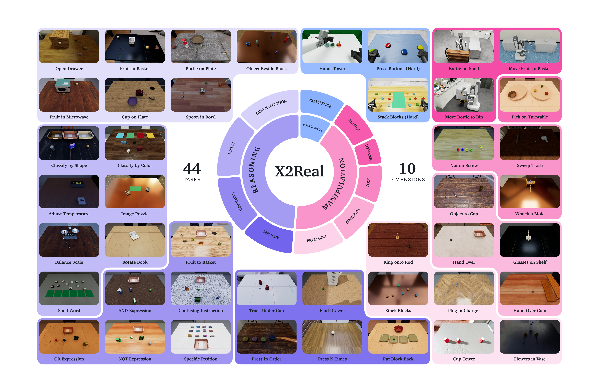
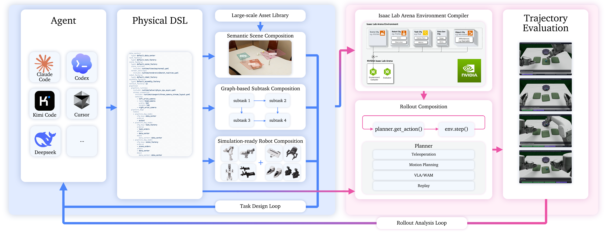

<div align="center">

<h1>X2Real</h1>

<h3>An eXtensive simulation benchmark for real-world generalist policies</h3>

<p><strong>Faithful · Diverse · Fair · Evolving</strong></p>

<p>
  <a href="README.zh-CN.md">简体中文</a> ·
  <a href="https://x2robot.com/en/pages/x2real">Project</a> ·
  <a href="https://arxiv.org/abs/2609.27449">Paper</a> ·
  <a href="https://huggingface.co/datasets/x-square-robot/x2real-assets">Assets</a> ·
  <a href="https://huggingface.co/datasets/x-square-robot/X2Real-Dataset">Dataset</a> ·
  <a href="#news">News</a> ·
  <a href="#highlights">Highlights</a> ·
  <a href="#documentation">Docs</a> ·
  <a href="#evaluation-suite">Evaluation</a>
</p>

<p>
  <a href="https://x2robot.com/en/pages/x2real"></a>&nbsp;
  <a href="https://arxiv.org/abs/2609.27449"></a>&nbsp;
  <a href="https://github.com/isaac-sim/IsaacSim/tree/release/6.0"></a>&nbsp;
  <a href="https://github.com/isaac-sim/IsaacLab/tree/release/3.0.0"></a>&nbsp;
  <a href="https://github.com/isaac-sim/IsaacLab-Arena"></a>&nbsp;
  <a href="https://www.python.org/downloads/release/python-3120/"></a>&nbsp;
  <a href="https://www.kernel.org/"></a>
</p>

</div>

<p align="center">
  
</p>

<p align="center"><em>X2Real task taxonomy. The paper defines 44 hierarchical long-horizon tasks across 10 core capability dimensions.</em></p>

<a id="news"></a>

## 📰 News

**2026-10-10:** **X2Real v0.9.0** is now open-source, including the ID evaluation runtime and release documentation.

<a id="highlights"></a>

## ✨ Highlights

<p align="center">
  
</p>

<p align="center"><em>Mana system overview. Physical DSL connects task design, environment compilation, policy rollout, and trajectory evaluation in two iterative loops.</em></p>

> X2Real provides ID evaluation and manual demonstration collection. ManaEnv
> owns environment construction, robot control, task execution, scoring, and
> result artifacts; Policy Space v2 services run policy inference separately.
> Keyboard, Vuer/WebXR, and master-arm collection run without a policy service.

- 🎯 **Faithful sim-to-real evaluation** — visual, physical, and low-level
  control calibration; the technical report records a `0.84` linear
  correlation between simulation and real-robot evaluation scores for the
  reported setup.
- 🧭 **Ten capability dimensions** — 44 reasoning, manipulation, and challenge
  tasks that combine atomic skills into hierarchical long-horizon behavior.
- 🎲 **Multi-axis diversity** — appearance, task setting, and embodiment
  randomization across assets, layouts, instructions, cameras, grippers, and
  table geometry.
- 🤖 **Five formal ID boards** — 73 runnable configurations spanning ArtiXon
  Arm-6A, Quanta X1, ARX R5, and Franka platforms.
- 🧩 **Evolving benchmark infrastructure** — Mana's Physical DSL composes
  scenes, Task DAGs, robot embodiments, and randomization rules into executable
  environments.
- 🔌 **Isolated policy runtimes** — versioned Policy Space contracts connect
  policies without moving model frameworks or checkpoints into the evaluator.
- 📊 **Reproducible result artifacts** — deterministic default seeding,
  board-defined budgets, materialized suites, structured reports, and episode
  recordings.

<a id="documentation"></a>

## 📚 Documentation

| Section | Description |
| :-- | :-- |
| [Install and Evaluation](#install-and-evaluation) | Install ManaEnv, start Policy Space, and run evaluation. |
| [Evaluation Suite](#evaluation-suite) | Boards and ID-case counts. |
| [Repository Structure](#repository-structure) | Key files and directories. |
| [Outputs and Scoring](#outputs-and-scoring) | Reports, videos, and resume runs. |
| [Manual Collection](#manual-collection) | Keyboard, Vuer/WebXR, master arms, and HDF5 demonstrations. |
| [Release Scope](#release-scope) | Included release content. |
| [Citation](#citation) | Cite the X2Real paper. |
| [License](#license) | License status. |

<a id="install-and-evaluation"></a>

## 🚀 Install and Evaluation

- Policy Space v2 provides the policy endpoint.
- ManaEnv handles the environment, tasks, scoring, and result artifacts.

### Requirements

- Linux with an NVIDIA GPU and a driver supported by Isaac Sim `6.0.1.0`
- Python `3.12` through Conda or uv
- A local X2Real simulation asset bundle

### 1. Install ManaEnv

```bash
source ./install.sh
```

The installer:

- Creates or activates the `manaenv` Conda environment.
- Installs the lightweight `policy-space-protocol` client.
- Builds traceable local Isaac Sim compatibility wheels for the
  [X2Real dependency profile](.agents/skills/x2real-install/SKILL.md#runtime-dependency-profile) and verifies `pip check`.

### 2. Prepare local assets

The checkout contains the asset manifest only.

- **Simulation assets:** download [X2Real assets](https://huggingface.co/datasets/x-square-robot/x2real-assets) and copy its `assets/` directory into this repository.
- **Dataset:** see the separate [X2Real Dataset](https://huggingface.co/datasets/x-square-robot/X2Real-Dataset); it is not bundled here.

Alternatively, set `MANAENV_ASSET_ROOT` to a local `assets/` directory:

```bash
export MANAENV_ASSET_ROOT=/path/assets
```

`assets/manifest.json` records the expected bundle version, file count, byte
count, and tree digest.

### 3. Start the Policy Space service

In another shell, use the fixed `3rd/policy_space` checkout:

```bash
cd 3rd/policy_space
python -m pip install --editable .
policy-space check policies/templates/bimanual_ee/deploy.yaml
policy-space serve policies/templates/bimanual_ee/deploy.yaml
```

The included template needs no checkpoint and is suitable for interface checks.

### 4. Start the connected evaluation

Keep the service running and execute the headless ID smoke case from the repository root:

```bash
python manaenv/scripts/x2real_eval.py   --board artixon_arm6a_tabletop   --env artixon_arm6a_G_pick_fruits_into_basket_id_env   --num-episodes 1   --num-parallel-envs 1   --policy-config policy/x2real_ps@v1.0.0.yaml   --server-address 127.0.0.1   --server-port 8001   --enable_cameras
```

Add `--viz kit` only when a local Kit window is needed.

For benchmark runs, replace the template deployment and policy configuration.
The policy name, schemas, embodiment, host, and port must match. The template
returns zero actions and only validates the interface.

<a id="evaluation-suite"></a>

## 🧪 Evaluation Suite

| Board | Platform and configuration | ID cases |
| :-- | :-- | --: |
| `artixon_arm6a_tabletop` | ArtiXon Arm-6A tabletop, G/H grippers | 38 |
| `artixon_arm6a_challenge` | ArtiXon Arm-6A challenge suite, H gripper | 10 |
| `quanta_x1_mobile` | Quanta X1 mobile manipulation | 3 |
| `arx_r5_tabletop` | ARX R5 tabletop | 12 |
| `franka_panda_tabletop` | Franka tabletop, Panda Hand | 10 |
| **Total** |  | **73** |

The paper groups 44 semantic tasks; the evaluator exposes 73 runnable ID cases.
Each case defaults to 40 episodes and four parallel environments.

<a id="repository-structure"></a>

## 🗂️ Repository Structure

```text
manaenv-pub/
├── install.py
├── install.sh
├── manaenv/
│   ├── scripts/x2real_eval.py
│   └── defination/
│       ├── x2real.yaml
│       └── x2real/task/
│           ├── boards.yaml
│           └── x2real_*_leaderboard.csv
├── assets/
├── 3rd/
│   ├── isaaclabarena/
│   │   └── submodules/IsaacLab/
│   │       └── IsaacSim/
│   └── policy_space/
└── outputs/x2real_eval/
```

The installer prepares dependencies under `3rd`:

- Arena → IsaacLab → Isaac Sim
- Newton via pip from the X-Square-Robot `x2real` reference
- Policy Space from `main`

`outputs/x2real_eval/` stores reports and videos.

<a id="outputs-and-scoring"></a>

## 📦 Outputs and Scoring

Reports are written to `outputs/x2real_eval/<board>/benchmark/`; videos are stored at:

```text
<save_path>/<environment>/videos/combined/episode_*.mp4
```

Use the same filters, episode budget, seed, and save path with `--resume` to
continue an interrupted run:

```bash
python manaenv/scripts/x2real_eval.py   --board artixon_arm6a_tabletop   --env artixon_arm6a_G_pick_fruits_into_basket_id_env   --num-episodes 40   --seed 42   --save-path ./outputs/x2real_eval/resumable-run   --resume
```

Reports are indexed in `benchmark_report.json`. Process completion and task
`success=true` are separate signals.

<a id="manual-collection"></a>

## 🎮 Manual Collection

Collect demonstrations on ArtiXon Arm-6A or Quanta X1 ID tasks with keyboard,
Vuer/WebXR, or master-arm input. No policy service is required.

```bash
python manaenv/scripts/x2real_collect.py --mode gendata \
  --env artixon_arm6a_G_pick_fruits_into_basket_id_env \
  --teleop keyboard --num-demos 10 --seed 42 \
  --save-path ./outputs/manual/fruits
```

Keyboard collection opens the Kit window. `Enter` saves; `R` discards and resets.
`--num-demos` counts successful demonstrations saved as HDF5.
Add `--dry-run` to preview the command without launching.

Use `--teleop vuer` or `--teleop masterslave` for other input devices. See the
[gendata skill](.agents/skills/x2real-gendata/SKILL.md) for task discovery,
device setup, controls, and data inspection.

<a id="release-scope"></a>

## ⚖️ Release Scope

- Evaluation requires a compatible Policy Space v2 endpoint and registered ID cases.
- Manual collection supports ArtiXon Arm-6A and Quanta X1 with keyboard,
  Vuer/WebXR, or WebSocket master-arm input and local HDF5 output. See the
  [instructions](#manual-collection) and [public scope](OPEN_SOURCE_SCOPE.md).
- Simulation assets and the [X2Real Dataset](https://huggingface.co/datasets/x-square-robot/X2Real-Dataset)
  are distributed separately; download assets from [X2Real assets](https://huggingface.co/datasets/x-square-robot/x2real-assets).

<a id="citation"></a>

## 📖 Citation

If you use X2Real in your research, please cite our [paper](https://arxiv.org/abs/2609.27449):

```bibtex
@misc{ruan2026x2realextensivesimulationbenchmark,
  title={X2Real: an eXtensive simulation benchmark for real-world generalist policies},
  author={Lian Ruan and Jade Yang and Sherphylan Gao and Felix Gao and
          Kyson Liang and Galen Liu and Ligo Wu and Lane Jin and Guu Gu and
          Bevan Xie and Cloud Yan and Zongzi Yuan and Kino Luo and Emma Chen and
          Shuwen Chen and Yang Ping and Miles Guo and Rain Sun and Kayden Zhang and
          Alex Du and Ruihai Wu and Liang Hao and Zhaoshuo Li and Roy Gan and
          Hao Wang and Qian Wang},
  year={2026},
  eprint={2609.27449},
  archivePrefix={arXiv},
  primaryClass={cs.RO},
  url={https://arxiv.org/abs/2609.27449},
}
```

<a id="acknowledgements"></a>

## 🙏 Acknowledgements

X2Real builds on open-source simulation and robotics infrastructure. We thank:

- [IsaacLab-Arena](https://github.com/isaac-sim/IsaacLab-Arena) for its open-source Isaac Lab simulation benchmark infrastructure.
- [Isaac Lab](https://github.com/isaac-sim/IsaacLab) for the framework used by Arena.
- [Isaac Sim](https://github.com/isaac-sim/IsaacSim) for the simulation runtime.
- [Newton](https://github.com/newton-physics/newton) for the physics backend.

<a id="license"></a>

## 📄 License

This repository is licensed under the [Apache License 2.0](LICENSE). Third-party components and separately distributed assets may carry their own licenses.
